<p align="center">
  <picture>
    <source media="(prefers-color-scheme: dark)" srcset="docs/assets/banner-on-dark.png">
    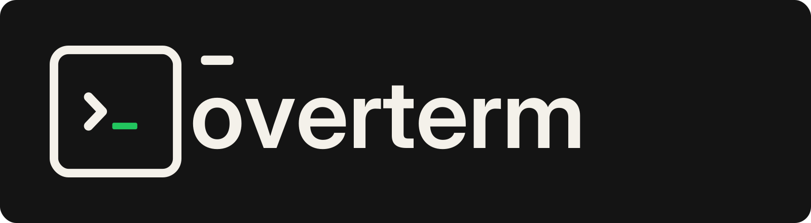
  </picture>
</p>

<p align="center">
  <b>A macOS terminal for working with agents.</b><br>
  Several worktrees at once, an agent in each, and a window that tells you which one needs you.
</p>

<p align="center">
  
  
  
  
</p>

<p align="center">
  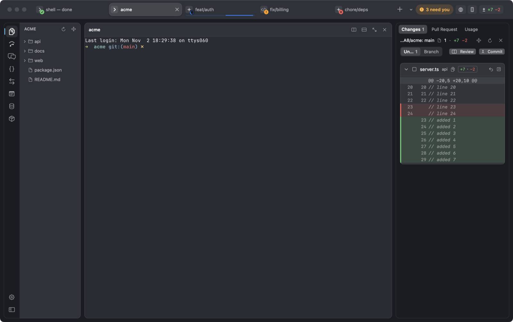
</p>

The terminal is [libghostty](https://github.com/ghostty-org/ghostty) inside a
Swift/AppKit app, so your `~/.config/ghostty/config` — font, theme, keybinds —
applies as it is. Everything around it is built for one thing: keeping five or
ten agent sessions straight. Each tab says what it is and what it wants —
**working**, **done**, **failed**, **needs you** — in the strip, in a
notification and on the Dock; Claude Code needs no setup for it.

---

## What's in it

<table>
  <tr>
    <td width="50%">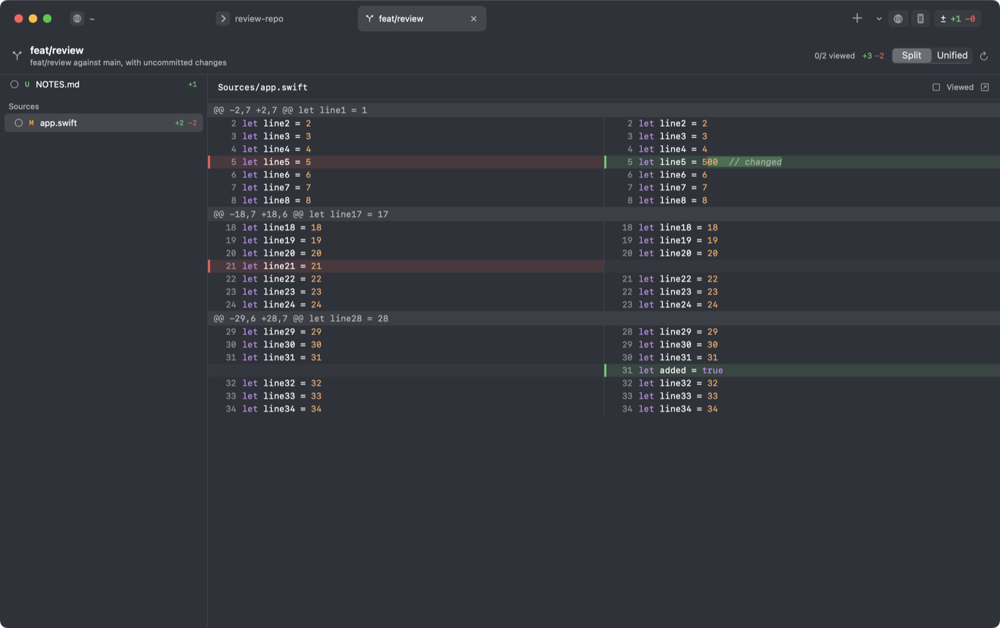</td>
    <td>
      <h3>Review <kbd>⇧⌘R</kbd></h3>
      A branch, some commits, what isn't committed yet, or a pull request
      (through your <code>gh</code>) in a tab of its own — the files on the left,
      each diff <b>side by side</b> or unified, viewed marks, and
      <code>j</code>/<code>k</code>, <code>n</code>/<code>p</code>, <code>v</code>
      to move through it. Full screen, it is the whole screen.
    </td>
  </tr>
  <tr>
    <td>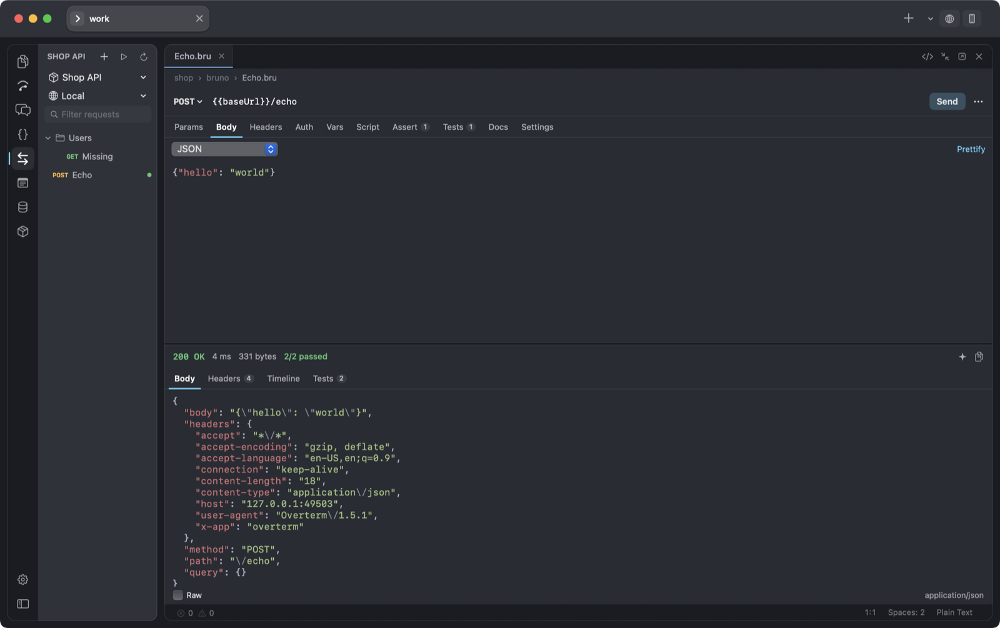</td>
    <td>
      <h3>API testing — Bruno's files <kbd>⌥⌘R</kbd></h3>
      The checkout's <a href="https://www.usebruno.com">Bruno</a> collection —
      requests by folder, environments — with Bruno's tabs: params, body, headers,
      auth, vars, scripts, asserts, tests, docs. Scripts and tests run as in Bruno,
      a folder runs top to bottom, and every edit is a minimal edit to the
      <code>.bru</code> you commit. Imports OpenAPI, Postman, <code>.http</code> and
      cURL; agents send requests over MCP.
    </td>
  </tr>
  <tr>
    <td>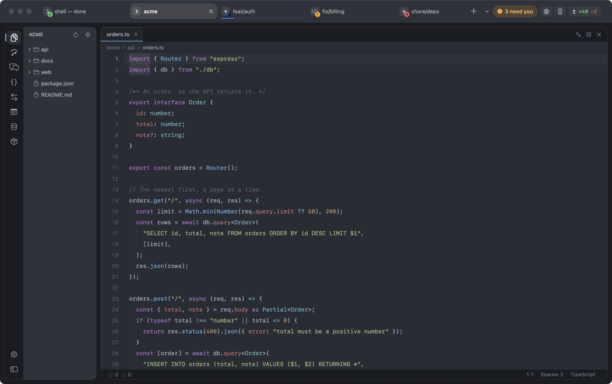</td>
    <td>
      <h3>Editor</h3>
      A file opens beside the terminal, Zed's way: tree-sitter colours, language
      servers (completion, go to definition, problems), Zed's keys and pickers,
      git marks in the gutter, and Vim mode if you want it. <kbd>⇧⎋</kbd> gives it
      the whole window; a double-click opens a file in the app you chose instead.
    </td>
  </tr>
  <tr>
    <td>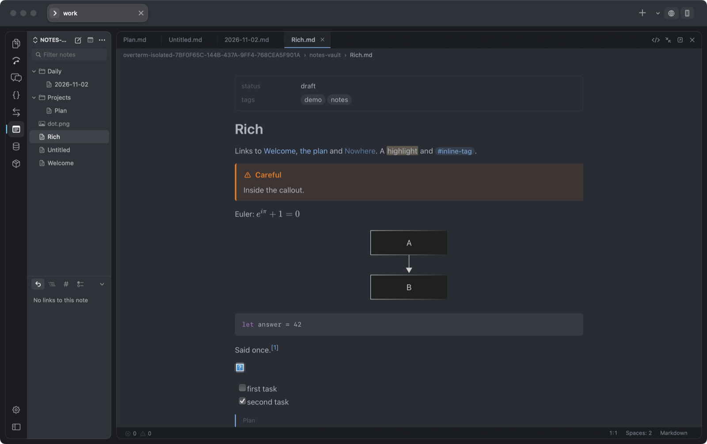</td>
    <td>
      <h3>Notes — your Obsidian vault <kbd>⌥⌘N</kbd></h3>
      Your vault as it is, in iCloud or anywhere: Live Preview, or the reading
      view with callouts, math, mermaid and code drawn offline. Backlinks,
      outline, tags, tasks and a graph; a rename takes its links with it; today's
      note and templates go where Obsidian's settings say.
    </td>
  </tr>
  <tr>
    <td>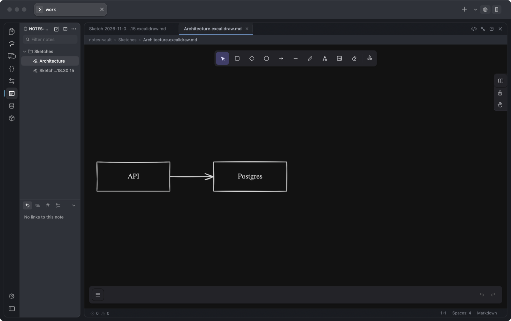</td>
    <td>
      <h3>Drawings</h3>
      New Drawing opens an Excalidraw canvas, saved as Obsidian Excalidraw's own
      file — drawn here, opened there, and back. A drawing embedded in a note is
      a picture in the reading view, and agents can draw a diagram for you
      (<code>notes_draw</code>).
    </td>
  </tr>
  <tr>
    <td>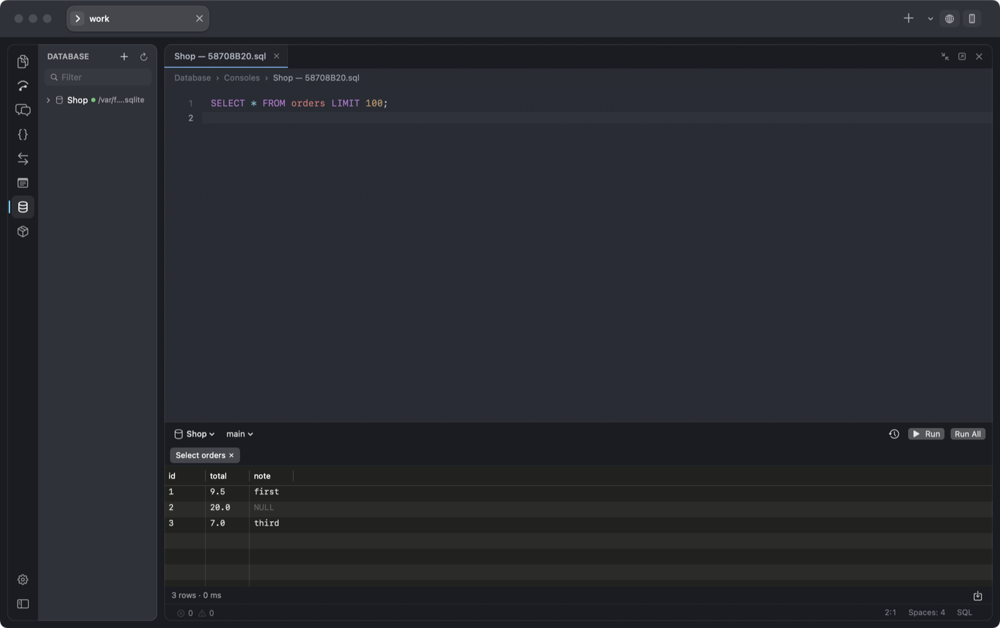</td>
    <td>
      <h3>Database <kbd>⌥⌘B</kbd></h3>
      PostgreSQL, MySQL, SQLite, Redshift, ClickHouse and BigQuery: schemas in the
      sidebar, any <code>.sql</code> file a console with completion, results in a
      grid you export. Passwords stay in your keychain; SSH tunnels through your own
      <code>~/.ssh</code>. S3 and Google Cloud Storage in the same panel.
    </td>
  </tr>
  <tr>
    <td>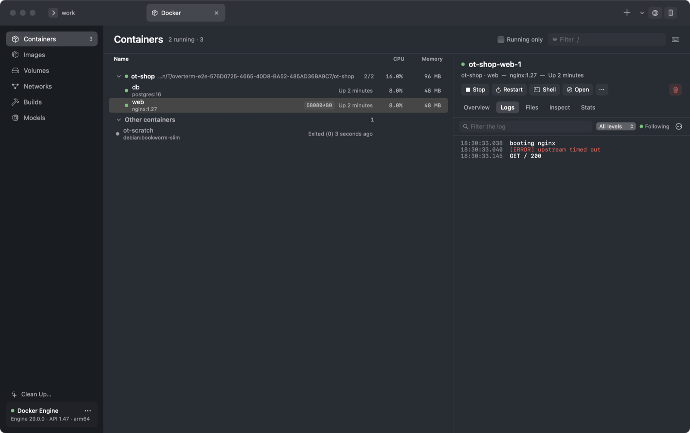</td>
    <td>
      <h3>Docker <kbd>⌥⌘P</kbd></h3>
      The containers your <code>docker</code> reaches, by compose project, kept
      live: logs coloured by level, files, CPU and memory, images, volumes,
      networks, builds and Scout's vulnerabilities. Two worktrees' stacks come up
      on free ports, a container that crashes marks its tab, and an agent can be
      asked why.
    </td>
  </tr>
  <tr>
    <td>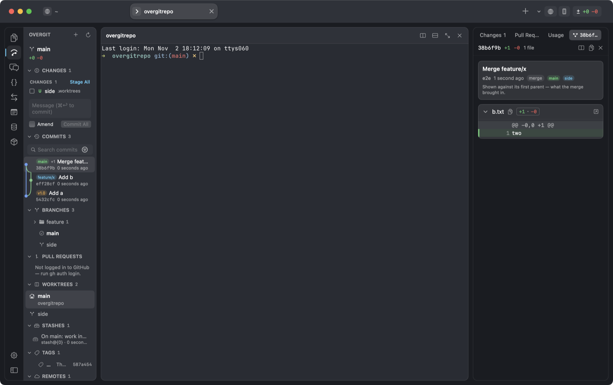</td>
    <td>
      <h3>Overgit <kbd>⌥⌘G</kbd></h3>
      One git home in the sidebar: changes to stage and commit, the commit graph,
      branches, pull requests and CI, worktrees, stashes, tags. A commit opens
      beside the terminal; any two compare. Merged worktrees clean up in a click.
    </td>
  </tr>
  <tr>
    <td>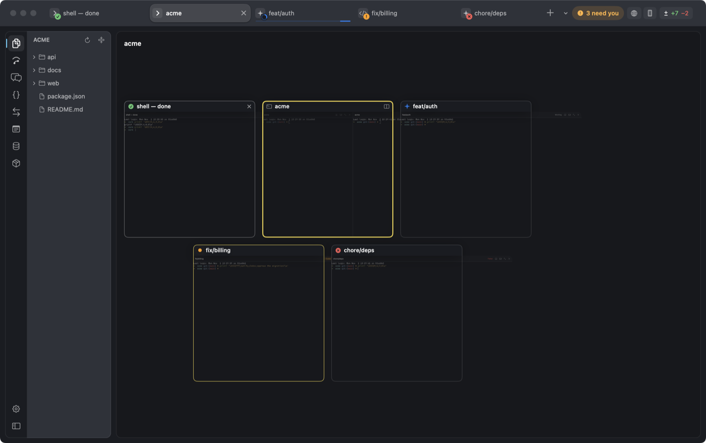</td>
    <td>
      <h3>Tab Peek <kbd>⇧⌘E</kbd></h3>
      Every tab as a live card — three fingers down on the trackpad, too. Tabs of
      one checkout group into <b>islands</b> you can fold, stash, focus on or
      broadcast to; splits give each pane a header with its status and ports.
    </td>
  </tr>
</table>

### And

| | |
|---|---|
| **Agent Inbox** <kbd>⌘I</kbd> | Every agent waiting on you, most urgent first, with its question and choices — answered from there. |
| **Changes** <kbd>⌥⌘D</kbd> | The worktree's files live, Uncommitted or the whole Branch — and *why* each changed, from what Claude said as it edited it. |
| **Command blocks** | A command's output, time and exit; ⇧⌘C copies it, ⌘R reruns it, ⌥⌘↓ jumps to the next failure. |
| **Palette** <kbd>⌘K</kbd> | Actions, tabs, worktrees, snippets — and what this machine has actually run, this folder's first. |
| **Agent overview** <kbd>⇧⌘A</kbd> | Every agent tab as a card: what it is working on, what it last said, and whether it waits for you. |
| **Claude sessions** | Every conversation ever run in the repository, in the sidebar — one click resumes it where it ran. |
| **Snippets** | Commands you keep, by name: pasted into the terminal or run, and found from ⌘K. |
| **Browser** <kbd>⇧⌘B</kbd> | A column beside the terminal that agents drive over MCP — and the iOS simulator, live and clickable, in the same place. |
| **Usage** <kbd>⌥⌘U</kbd> | What is left of Claude's and Codex's windows, and what the day would cost — read from their own files, nothing over the network. |
| **⌘L** | The selection to an agent, with the command it came from, its exit code and the diff. |
| **New Task** <kbd>⇧⌘N</kbd> | A worktree, a branch and an agent tab in one go — and its compose stack, on free ports if another worktree's has them. |
| **Search** <kbd>⌘F</kbd> | The scrollback, the checkout's file names and their contents; ⌘-click a `path:line` to open it. |
| **Agents over MCP** | Claude Code started here reaches the browser, the notes, the API client, the databases and Docker — reads freely, asks you before anything writes. |
| **Restored** | Tabs, names, splits and islands come back on relaunch: shells with their last 2000 lines, agent tabs resuming their conversation. |

How each works, in detail: [docs/architecture.md](docs/architecture.md).

---

## Install

**Homebrew.**

```sh
brew install --cask overcraft-hq/tap/overterm
```

**Without Xcode — the release DMG.** Download `Overterm-<version>.dmg` from
[Releases](https://github.com/Overcraft-hq/overterm/releases), open it and drag
**Overterm** to **Applications** (Apple silicon, macOS 13+). It is signed ad hoc
and not notarized, so macOS stops the first open: right-click → **Open** (macOS
15 and later: System Settings → Privacy & Security → **Open Anyway**), or

```sh
xattr -dr com.apple.quarantine /Applications/Overterm.app
```

**From source** — see [Build](#build).

## Keys

The defaults; every one is rebindable in Settings ▸ Keyboard Shortcuts (or
`keybindings.json`).

| | |
|---|---|
| ⌘T / ⌘W | New tab / close the pane, else the tab |
| ⌥⌘C / ⌥⌘X | New Claude / Codex tab here |
| ⇧⌘N | New Task — worktree, branch, agent |
| ⇧⎋ | The editor across the window, and back |
| ⌘K | Command palette |
| ⌘I | Agent Inbox · ⌃⌘I Tab Info · ⇧⌘A agent overview |
| ⌥⌘↓ | The next failure, or tab that needs you |
| ⌘D / ⇧⌘D | Split right / down · ⌘[ ⌘] between panes · ⇧⌘↩ zoom |
| ⌃⌘N / ⌃⌘G | Group the selected tabs / the group switcher |
| ⌃⌘1…9 | Go to a group · ⌃⌘F focus · ⌃⌘S stash · ⌃⌘B broadcast |
| ⌘R / ⇧⌘C | Run the last command again / copy its output |
| ⌘L | Ask an agent about the selection |
| ⌘F | Search the terminal and the files |
| ⇧⌘R | Review the branch |
| ⌘B / ⌥⌘D | Sidebar / changes |
| ⌥⌘G · ⌥⌘N · ⌥⌘R · ⌥⌘B | Overgit · notes · API client · database |
| ⌥⌘P / ⇧⌥⌘P | Docker / find a container |
| ⇧⌘B · ⌥⌘U | Browser · usage |
| ⇧⌘E | Tab Peek (or three fingers down) |
| ⌘, / ⌥⌘O | Settings / what's new |

## Settings

⌘, opens a tab, not a window. Every section switches between controls and the
JSON behind it — `settings.json` and `keybindings.json` in
`~/Library/Application Support/Overterm/`, VS Code's two files, editable by
hand: only what you changed is in them, comments are fine, and an edit applies
at once. **Themes** is a gallery — each theme drawn as a little window in its
own colours: Ghostty's 800-odd, and yours from `~/.config/ghostty/themes`.

## Build

Requirements: macOS 13+, Xcode 16.4 (what CI and releases build with),
[mise](https://mise.jdx.dev). With another Xcode selected, point the shell at
16.4 — the system's choice stays:

```sh
export DEVELOPER_DIR=/Applications/Xcode-16.4.app/Contents/Developer
```

```sh
mise trust && mise install   # the pinned Zig
make ghosttykit              # GhosttyKit from the pinned Ghostty (once, a few minutes)
make treesitter              # the editor's grammars (once)
make hooks                   # the git hooks (once)
make test                    # unit and integration tests
make e2e                     # end-to-end scenarios in the real app (opens windows)
make run                     # build Overterm.app and open it
make install                 # …and copy it to /Applications
```

Builds are signed ad hoc, so each one is a new app to macOS, and a permission
such as the microphone is asked for again. Set `SIGN_IDENTITY` — in the
environment, or an untracked `local.mk` next to the Makefile — and
`make install` re-signs the installed copy with it:

```make
# local.mk (gitignored); list yours with: security find-identity -v -p codesigning
SIGN_IDENTITY ?= Apple Development: Your Name (TEAMID1234)
```

## Versions and releases

`VERSION` is the version, `CHANGELOG.md` what each one changed; **About
Overterm** shows it with the commit it was built from. A version gathers
commits on a branch until it is released: the first change after a release
starts it (`Scripts/bump-version.sh patch "area: what changed"`), the next ones
add their line to its entry. Released, it is merged to `main` and tagged
`v<VERSION>`; then GitHub → Actions → **Release** → Run workflow builds the app
and a DMG on a macOS runner and publishes it with its `CHANGELOG.md` entry as
the notes. `make hooks` keeps an app change from landing on a version already
released. The details: [CLAUDE.md](CLAUDE.md), Commits.

The README's pictures are taken by the app itself, in its isolated test mode,
from made-up data — `OVERTERM_E2E=showcase OVERTERM_DUMP_PNG=… OVERTERM_E2E_CWD=<an empty folder> ./Overterm.app/Contents/MacOS/Overterm`,
and the api, review, notes, drawing, database, overgit and docker scenarios the
same way. The empty folder matters: the first tab starts there, and the window
follows it — from your home folder it would find your own collections.

## Under the hood

Ghostty v1.4.0 with Zig 0.17.0 (`Scripts/build-ghosttykit.sh`, `mise.toml`);
state in `~/Library/Application Support/Overterm/` — `session.json`,
`snippets.json`, `history.json`, the saved scrollback.

More in `docs/`: [architecture](docs/architecture.md),
[the Ghostty embedding](docs/ghostty.md), [testing](docs/testing.md),
[debugging](docs/debugging.md). The house rules are in [CLAUDE.md](CLAUDE.md).
