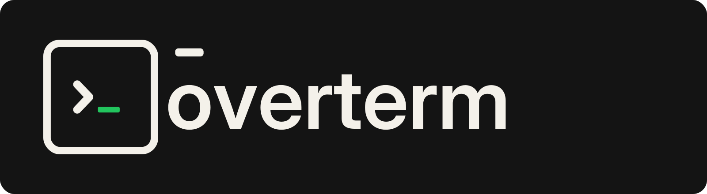
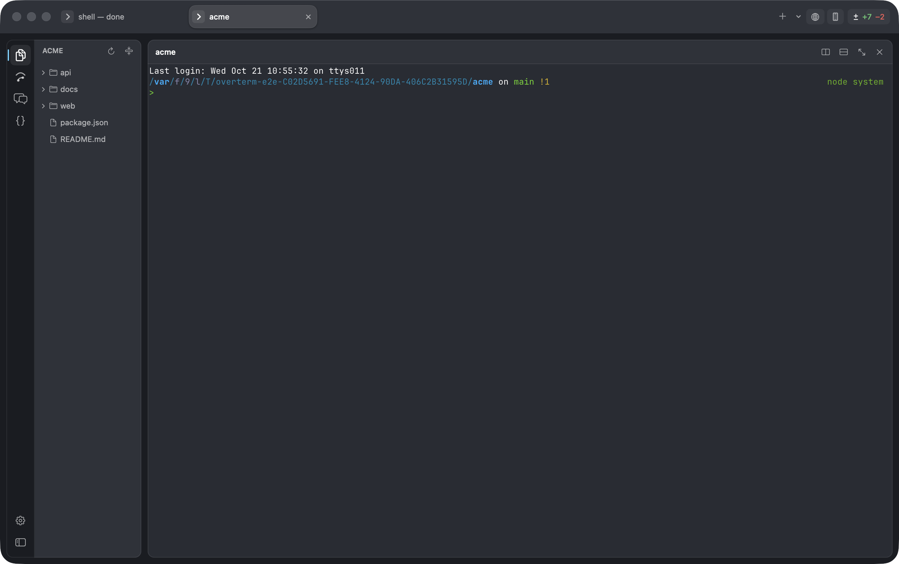
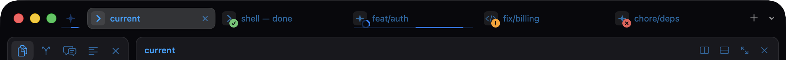
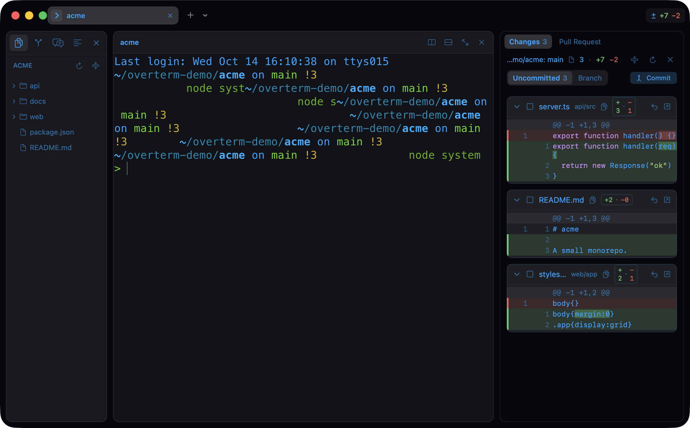
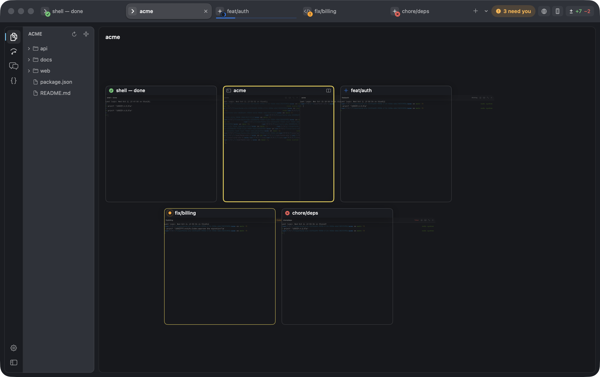

<p align="center">
  <picture>
    <source media="(prefers-color-scheme: dark)" srcset="docs/assets/banner-on-dark.png">
    
  </picture>
</p>

<p align="center">
  <b>A macOS terminal for working with agents.</b><br>
  Several worktrees at once, an agent in each, and a window that tells you which one needs you.
</p>

<p align="center">
  
  
  
  
</p>

<p align="center">
  
</p>

The terminal itself is [libghostty](https://github.com/ghostty-org/ghostty)
(`GhosttyKit`) inside a Swift/AppKit app, so your `~/.config/ghostty/config`
— font, theme, keybinds — applies as it is. Everything around it is built for
one thing: keeping five or ten agent sessions straight.

---

## What it does

### Tabs that say what is happening in them



Each tab carries what it is (agent, server, shell, ssh) and what it wants:
**working** (a spinner), **done**, **failed**, or **needs you** — a bell, or an
agent's permission prompt. In the background it is also a macOS notification
and a Dock badge, and ⌥⌘↓ jumps to the next one. Claude Code needs no setup
for it: it already speaks the Ghostty notification and progress sequences.

### Groups, as islands in the strip

Tabs of one checkout become an **island**: a coloured chip, its own run in the
strip, and the tabs' marks summed on it. Collapse one, **stash** it out of the
way (it keeps running), **focus** on it so the strip shows nothing else, or
**broadcast** a line into every tab in it. ⌃⌘1…9 go straight to one.

A new tab never silently joins an island — ⌘T and the strip's `+` open outside
it; the island's own `+` opens inside it.

### Agent Inbox (⌘I)

Every agent waiting on you in one list, most urgent first, with the question
and its choices read off the screen: **Approve ↩**, **Always allow**,
**Deny ⌫** — answered where you are, without walking the tabs.

### Changes, with the reason each file changed



The ± badge counts the tab's worktree; the pane shows the files, live, with
**Uncommitted** (stage, discard, commit) or **Branch** (everything since the
branch left `main`, its commits listed). Each file can say *why* it changed:
what Claude said when it edited it, read from Claude Code's own session files
on this Mac — nothing leaves it.

### Panes, and a card of every tab



Split a tab (⌘D, ⇧⌘D) and every pane gets a 38 pt header: what runs in it,
its island, its status, the ports it listens on, and split / zoom / close.
Drag a tab onto a pane to split with it. **Tab Peek** (⇧⌘E, or three fingers
down) scales every tab into a card.

### The things a terminal should have known

- **Command blocks** — what a command printed, how long it took and how it
  ended; a failed one is ringed in the grid, with **Copy output** (⇧⌘C) and
  **Rerun** (⌘R) pinned in the pane's header. A gutter down the pane's edge
  maps the blocks in the scrollback.
- **⌘K palette** over your actions, tabs, worktrees, snippets and **what this
  machine has actually run** — this folder's commands first, with the exit
  code and how long they took. ↩ runs, ⌥↩ pastes without running.
- **Live ports** — a pill in the pane header for whatever is listening:
  open it, copy the URL, or kill the exact pid.
- **⌘L** hands the selection to an agent, with the command it came from, the
  exit code and the diff, if you want them.
- **Search** (⌘F) — one overlay over the scrollback, the checkout's file names
  and their contents. ⌘-click a `path:line` in the output to open it in the
  editor at that line.
- **Drop files on a terminal** from Finder, Safari, Photos or the sidebar: a
  shell gets quoted paths, Claude Code gets `@`-mentions and images it can
  read. Nothing runs until you press Return.

### What the agents are costing you

<kbd>⌥⌘U</kbd>, or the gauge at the right of the strip: what is left of
Claude's five-hour and weekly windows and of Codex's, with the countdown to
each reset, and what the day's tokens would cost at list prices. Both are
read from the files the agents write on this Mac — nothing is asked over
the network, and nothing needs a key.

### And the work around the work

**New Task** (⇧⌘N) makes a worktree, a branch and a tab with an agent started
in it. **Merged worktrees** are marked and cleaned up in one click, keeping
anything with changes, a tab or unpushed commits. **Pull requests** and CI
(through your `gh`) sit on the worktree, in the strip, and in a pane of their
own. **Claude sessions** lists every conversation ever run in the repository,
and resumes one where it ran. The **editor** opens a file beside the terminal;
a double-click opens it in the app you chose.

Tabs, their names, colours, pins, directories, splits and islands come back on
relaunch — shell panes with their last 2000 lines, agent tabs resuming their
conversation.

---

## Install

**Homebrew.**

```sh
brew install --cask overcraft-hq/tap/overterm
```

**Without Xcode — the release DMG.** Download `Overterm-<version>.dmg` from
[Releases](https://github.com/Overcraft-hq/overterm/releases), open it and drag
**Overterm** to **Applications** (Apple silicon, macOS 13+). It is signed ad hoc
and not notarized, so macOS stops the first open: right-click → **Open** (macOS
15 and later: System Settings → Privacy & Security → **Open Anyway**), or

```sh
xattr -dr com.apple.quarantine /Applications/Overterm.app
```

**With Xcode — from source.** The Command Line Tools alone can't build
GhosttyKit; it needs `xcodebuild` and the Metal compiler.

```sh
mise trust && mise install   # the pinned Zig
make ghosttykit              # GhosttyKit from the pinned Ghostty (once, ~2 min)
make install                 # build Overterm.app and copy it to /Applications
```

## Keys

The defaults; every one of them is rebindable in Settings ▸ Keyboard Shortcuts
(or `keybindings.json`), menu items and the terminal's keys alike.

| | |
|---|---|
| ⌘T / ⌘W | New tab / close the pane, else the tab |
| ⌥⌘C / ⌥⌘X | New Claude / Codex tab here |
| ⇧⌘N | New Task — worktree, branch, agent |
| ⌘K | Command palette: actions, tabs, worktrees, snippets, history |
| ⌘I | Agent Inbox · ⌃⌘I Tab Info · ⇧⌘A agent overview |
| ⌥⌘↓ | Jump to the next failure or tab that needs you |
| ⌘D / ⇧⌘D | Split right / down · ⌘[ ⌘] between panes · ⇧⌘↩ zoom |
| ⌃⌘N / ⌃⌘G | Group the selected tabs / the group switcher |
| ⌃⌘1…9 | Go to a group · ⌃⌘F focus · ⌃⌘S stash · ⌃⌘B broadcast |
| ⌘R / ⇧⌘C | Run the last command again / copy its output |
| ⌘↑ / ⌘↓ | Previous / next prompt |
| ⌘L | Ask an agent about the selection |
| ⌘F | Search the terminal and the files |
| ⌘B / ⌥⌘D | Sidebar / changes |
| ⇧⌘E | Tab Peek (or three fingers down) |
| ⌘, / ⌥⌘O | Settings / what's new |
| ⌘-click | Open a printed `path:line` in the editor |
| ⌥ while dropping | Plain quoted paths, even where Claude Code runs |

## Settings

⌘, opens a tab, not a window. Every section switches between controls and the
JSON behind it — `settings.json` and `keybindings.json` in
`~/Library/Application Support/Overterm/`, VS Code's two files, editable by
hand (only what you changed is in them, comments are fine, and a hand edit
applies at once). General, Appearance, **Themes**, Terminal (over your Ghostty
config, applied to open terminals immediately), Agents, Editor, Notifications,
Keyboard Shortcuts, and About — the version, what's new, and updates from
GitHub releases.

**Themes** is a gallery, not a menu of names: each one drawn as a little
window in its own colours. It opens on ten — the ones people name — and
**All** is the whole catalogue of 473: Ghostty's own, ten more bundled beside
them, and anything in your `~/.config/ghostty/themes`, marked *Yours*. Pick
one and the terminals you have open change as you do — the strip, the
sidebar and the panes with them. "Follow macOS between a
light and a dark theme" keeps one of each and switches with the system.

## Build

Requirements: macOS 13+, Xcode 16 or 26.2, [mise](https://mise.jdx.dev).
Newer SDKs don't work yet: the pinned Zig 0.15.2 can't link against the macOS
26.5 and 27 SDKs (their libSystem lists only arm64e), and Xcode 27's SwiftPM
builds an app macOS runs in 13.0 compatibility mode. With such an Xcode
selected, point the shell at a supported one; the system's choice stays:

```sh
export DEVELOPER_DIR=/Applications/Xcode-26.2.app/Contents/Developer
```

Xcode 26 downloads the Metal compiler separately — if `make ghosttykit` can't
find `metal`: `xcodebuild -downloadComponent MetalToolchain`.

```sh
mise trust && mise install   # the pinned Zig
make ghosttykit              # GhosttyKit from the pinned Ghostty (once, ~2 min)
make hooks                   # git hooks: version bump check, release tags (once)
make test                    # unit + integration tests (~30 s)
make e2e                     # end-to-end scenarios in the real app (~2 min)
make run                     # build Overterm.app and open it
make install                 # …and copy it to /Applications
```

Builds are signed ad hoc, which makes every one of them a new app to macOS: a
permission such as the microphone would be asked for again after each update.
Set `SIGN_IDENTITY` — in the environment, or an untracked `local.mk` next to
the Makefile — and `make install` re-signs the installed copy with it, so the
grants stay (`make app`, `test` and `e2e` stay ad hoc and never touch the
keychain):

```make
# local.mk (gitignored); list yours with: security find-identity -v -p codesigning
SIGN_IDENTITY ?= Apple Development: Your Name (TEAMID1234)
```

## Releasing

Push the commit and its `v<VERSION>` tag (`git push origin main --tags`), then
GitHub → Actions → **Release** → Run workflow: a macOS runner tests, builds the
app and a DMG, and publishes `v<VERSION>` with that version's `CHANGELOG.md`
entry as the notes. It refuses a version already released — bump first.
Nothing triggers it on push. Locally, the same pieces are `make app dmg` and
`Scripts/release-notes.sh`.

## Versioning

`VERSION` holds the version ([SemVer](https://semver.org)), `CHANGELOG.md` what
each version changed, and the commit that brings a version is tagged
`v<version>`. **Overterm ▸ About Overterm** shows it — "Version 1.30.0 (147)",
the brackets counting commits — with the commit it was built from and the day.

```sh
make hooks                                          # once per clone
Scripts/bump-version.sh minor "tabs: what changed"  # or patch, major
git add VERSION CHANGELOG.md                        # commit them with the change
```

The pre-commit hook refuses a change to the app without a new VERSION; the
post-commit hook adds the tag. Tags stay local until you push them.

## Under the hood

Ghostty is pinned to v1.3.1 (`Scripts/build-ghosttykit.sh`); state lives in
`~/Library/Application Support/Overterm/` — `session.json`, `snippets.json`,
`history.json`, the saved scrollback.

More in `docs/`: [architecture](docs/architecture.md),
[the Ghostty embedding](docs/ghostty.md), [testing](docs/testing.md),
[debugging](docs/debugging.md). The house rules are in
[CLAUDE.md](CLAUDE.md).
